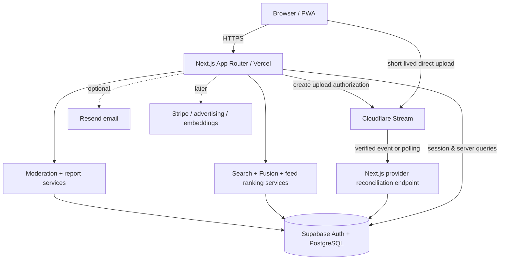
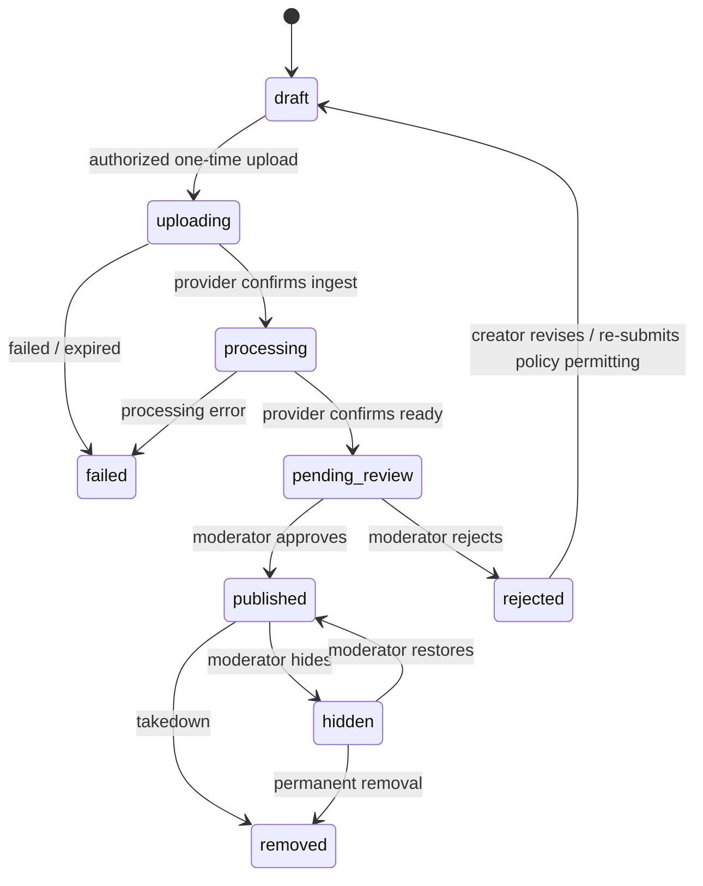

# AIVerse — System Architecture

Status: MVP blueprint · 2026-10-24

> Source of product requirements: [AIVERSE_CODEX_BUILD_SPEC.md](./AIVERSE_CODEX_BUILD_SPEC.md). This document describes engineering boundaries and implementation contracts; it does not imply that integrations or accounts already exist.

## 1. Architectural goals

AIVerse is a web-first, AI-generated entertainment catalog with guest viewing, approved creator uploads, human moderation, semantic-like search, and **Fusion** discovery (cultural/regional content inspiration × genre × format). Prefer reliable small vertical slices over premature scale. Never use a person's actual ethnicity, inferred ethnicity, or facial traits as a preference; content-region tags describe **content themes**, not people.

Nonnegotiable invariants:
1. Only `published` and nonremoved video records may appear in public search, feeds, Fusion, or watch pages.
2. No unapproved creator may receive a video upload authorization.
3. An uploaded video must successfully process **and** pass human review before public playback.
4. Server checks and Postgres RLS both enforce access; browser state is not authorization.
5. Search and recommendations only return actual catalog video IDs; never fabricate results.
6. Paid subscriptions/ads/payouts are not required for MVP functionality.

## 2. Topology



Deploy as one modular Next.js application initially. Supabase owns canonical metadata, auth, authorization state and audit records. Cloudflare Stream owns binary video ingest, encode and delivery. Service provider keys remain server-side; uploaded binaries do not transit the Next.js hosting runtime. Avoid implementing isolated microservices, queues or custom video transcoding during MVP.

## 3. Code organization (proposed)

```text
src/
  app/
    (public)/              # home, reels, movies, search, fusion, tag, watch, channel
    (auth)/                # signup, login, onboarding
    (creator)/studio/      # creator application/upload/status
    (admin)/admin/         # approvals, videos, reports, audit
    api/                   # handlers: upload auth, provider reconcile/webhook, events
  components/              # reusable accessible presentation
  features/
    auth/                  # roles, guards, session helpers
    onboarding/            # preference forms and validation
    discovery/             # search, fusion, feed
    videos/                # metadata, playback, upload FSM
    creators/              # application and quotas
    moderation/            # review, reports, audit
    analytics/             # event ingestion and cost summaries
  lib/
    supabase/              # server/client adapters, typed queries
    cloudflare/            # isolated Stream adapter
    schemas/               # zod input contracts
    config/                # limits and feature flags
supabase/migrations/       # ordered SQL with RLS + indexes
supabase/seed.sql          # development-only clearly tagged fixtures
tests/                     # unit/integration/e2e as appropriate
```

Keep Next.js route handlers thin. Business logic belongs in services with explicit user/context parameters and should be unit-testable. Default to server components for read-heavy pages; client components for playback, onboarding and interactive Fusion.

## 4. Core data model

Use UUID primary keys where appropriate, timestamps (`created_at`, `updated_at`), database constraints and targeted indexes. Additive roles via `user_roles(user_id, role)` with `viewer|creator|moderator|admin`. An approved application may grant `creator`; it is not solely determined by a client-editable profile flag.

| Domain | Tables | Key constraints |
|---|---|---|
| Identity | `profiles`, `user_roles` | one profile per auth user; composite unique role |
| Creators | `creator_applications`, `creator_profiles`, `creator_invites` | explicit `pending/approved/rejected`, admin decision metadata |
| Taxonomy | `genres`, `content_regions`, `languages`, `hashtags` | normalized unique slugs; labels kept distinct from people |
| Catalog | `videos`, `video_genres`, `video_content_regions`, `video_languages`, `video_hashtags` | one owner, typed status, unique join pairs, unique provider UID when present |
| Personalization | `viewer_genre_preferences`, `viewer_region_preferences`, `user_saved_fusions` | owner-scoped; unique selections; skip allowed |
| Engagement | `likes`, `follows`, `watch_events` | idempotent likes/follows; bounded events and retention |
| Trust | `reports`, `moderation_actions`, `audit_logs` | actions immutable or append-only; reviewer and reason |

Suggested `videos` fields: `id`, `creator_id`, `title`, `description`, `format` (`reel|movie`), `status`, `stream_uid`, `duration_seconds`, `thumbnail_url`, `rights_attested_at`, `ai_disclosed`, `generation_tools`, `language`, `published_at`, `created_at`, `updated_at`, `failure_reason`, `moderation_note` (private). Prefer dedicated join tables for multi-value tags instead of comma-separated strings.

Add useful indexes: videos `(status, published_at DESC)` and `(creator_id, created_at DESC)`; FK indexes on all join tables; unique hashtags on lowercase canonical slug; full-text search index on public title/description once implemented. Paginate feeds and cap result sizes. Use migrations; never silently change production schema.

## 5. Authorization + RLS matrix

| Actor | Published video | Draft/nonpublic video | Upload authorization | Moderation |
|---|---|---|---|---|
| Guest | read | none | none | none |
| Viewer | read | none | none | report content |
| Approved creator | read | own only | own, quota-checked | report content |
| Moderator | read | review queue as authorized | only if additionally creator | review/report decisions |
| Admin | read | manage | eligible according to policy | manage + audit |

Viewer interests and saved Fusion records are readable/writeable only by their owner. Review notes, reports, upload authorization records, provider secrets and audit logs are never public. No browser should use a Supabase service-role key. Restrict role changes to audited admin server functions, not arbitrary profile updates. Verify unauthorized read/write attempts in automated tests.

## 6. Video upload and publication state machine



Upload steps:
1. Authenticated server validates approved creator, MIME/type, quota (proposed: max 3 uploads/day and 30 minutes/month), max per-video duration (3 min initially), and rate limit.
2. Server creates a video draft plus short-lived direct-upload authorization with Cloudflare Stream; use an idempotency key and bind asset ownership to authenticated account.
3. Browser transfers file directly to provider. Browser progress is **not** evidence of successful processing.
4. Provider status is reconciled server-side using authenticated provider queries and verified callback if supported. Reject unauthenticated callback requests and replay attempts.
5. Successful encoding moves to `pending_review`, with private playback only through short-lived authorized access tokens.
6. Moderator records approve/reject decision and reason; publication transaction sets `published_at` and status atomically.
7. Enforce rejected/removed media retention and cleanup policies; monitor stored/delivered minutes and unused uploads.

Do not expose publicly usable Stream playback URLs for private videos. Store provider UID privately or expose only if safe behind access control. Disable aggressive reel prefetch; one playing video with at most one conservatively preloaded candidate.

## 7. Search, Fusion and feed

**Fusion inputs**: `content_region_slug`, `genre_slug`, `format=all|reels|movies`, optional language and sort. Validate against server taxonomy; do not infer a creator's nationality or an actor's ethnicity. Shareable canonical URL, e.g. `/fusion?region=korean&genre=romance&format=reels`. Guests can use filters, signed-in users can save them.

Retrieval pipeline:
1. Always filter by `status='published'`, visibility and takedown restrictions.
2. Apply validated exact filters (region/genre/format/language/duration).
3. For free-form search use Postgres full-text and title/tag/description matching (hybrid vector similarity later behind a provider interface).
4. Rank using simple measurable factors: candidate relevance, watch completion, engagement, freshness, genre/region preferences, creator diversity, and `not interested` signals.
5. Return actual video rows with pagination and a reason grounded in metadata. If no exact matches, explicitly label broader recommendations; never invent matches.

Onboarding suggests selecting 5–8 genres, followed by optional cultural **content** interests. Users may skip and edit later. Hashtags are normalized (max 10, suggest 3–5) and never a direct pay-to-rank mechanism. Search assistant parses conversational descriptions and maps them to verified filter and retrieval APIs; an LLM may improve intent parsing later, but cannot invent videos.

## 8. Main server contracts (illustrative)

These are proposed endpoints, not deployed routes; use Next.js server actions when more appropriate.

| Endpoint | Purpose / enforcement |
|---|---|
| `POST /api/creator/applications` | validate, rate-limit, create user's application |
| `POST /api/admin/creators/:id/decision` | audited admin approval/rejection |
| `POST /api/uploads/authorize` | role + quota + media validation; return limited direct-upload URL |
| `POST /api/videos/:id/reconcile` | server checks provider processing state |
| `POST /api/provider/cloudflare/webhook` | authenticate + dedupe provider events, if available |
| `POST /api/admin/videos/:id/decision` | moderator action with reason |
| `GET /api/discovery/search` | public published videos only |
| `GET /api/discovery/fusion` | sanitized filters and pagination |
| `POST /api/me/preferences` | session-scoped genre/region choices |
| `POST /api/me/fusions` | session-scoped saved combinations |
| `POST /api/videos/:id/report` | authenticated abuse report with rate limits |

Validate all JSON inputs using Zod. Never trust user-provided `creator_id`, role, cost or publication status. Deduplicate repeated client events and provider notifications. Enforce bounded page sizes, secure headers, request size limits and CSRF protection according to auth approach.

## 9. Security, trust and privacy

- Require content rights attestation and visible AI labels. Create takedown/appeal/report paths, block prohibited impersonation and abusive media, and record reviewer decisions.
- Collect only content preferences; avoid actual ethnicity collection and sensitive-inference categorization.
- Sanitize user-supplied text, links, tags and filenames; prohibit dangerous HTML. Validate external portfolio URLs.
- Apply rate limiting for signups, applications, upload grants, search, events, likes, and reports.
- Separate development/staging/production projects and secrets. Keep `.env.example` placeholder-only; never commit credentials or personally identifiable data.
- Limit watch telemetry to useful aggregates, with retention and deletion policy and user-privacy controls.
- Assess copyright, privacy and advertising rules with qualified review prior to public monetization.

## 10. Cost and operations

Track Cloudflare stored minutes, delivered minutes (including preloads), user-uploaded minutes, upload failure rate, median playback startup, unique engaged viewers, return rate, moderation turnaround and reports. Add warnings/soft upload throttles at spend thresholds. Do not assume display ads cover stream costs. Ad placements can be placeholders only until provider approval; never represent mock revenue as actual earned income.

Use managed error monitoring, structured logs without secrets, daily backups and a basic incident response/runbook. Explicitly document manual provisioning for Supabase, Cloudflare, Vercel and email/AI services.

## 11. Implementation order and quality gates

1. **Foundation:** Next.js scaffold, basic navigation, schema + RLS, auth, genre/region onboarding, settings, seeded public demo catalog.
2. **Discovery:** published-only listings, reels, movies, watch, full-text search, hashtags, Fusion and saved Fusion.
3. **Creator safety:** creator application/review, upload authorization, processing reconciliation, private moderation preview, publish/reject and user reports.
4. **Beta readiness:** observability, cost tracking, quotas and abuse controls, accessibility, authorization tests, performance checks and deploy docs.
5. **Post-MVP:** LLM/embeddings, premium subscriptions, ads, payouts, longer videos, automated moderation and native apps.

**Definition of done per slice:** routes work in local dev (or honestly documented stubs); migrations apply to clean DB; RLS tests prove prohibited access denied; typecheck/lint/tests pass; error/empty/loading states handled; documented setup and changed files; no credentials in git.

## 12. Architectural decision records to write as implemented

- ADR-001: modular monolith and provider boundaries
- ADR-002: Cloudflare direct video upload and private preview
- ADR-003: content region vs personal ethnicity distinction
- ADR-004: published-only retrieval and search fallback
- ADR-005: video lifecycle, reconciliation, deletion and audit
- ADR-006: measurement plan and cost budgets

Keep this architecture synchronized with real implementation. When a proposal changes, update this document and record the decision rather than silently diverging.
